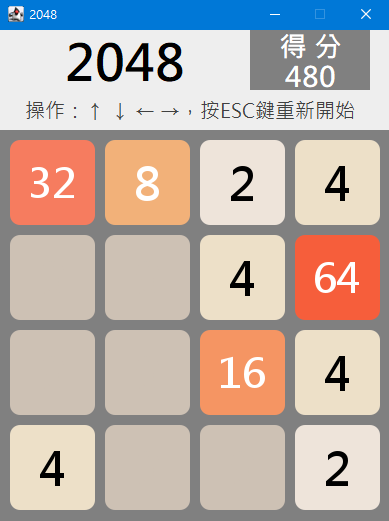

# Java 2048 遊戲

使用 Java Swing 製作的桌面版 2048 數字益智遊戲。透過方向鍵移動方塊，將相同數字合併並累積分數。

> 本專案為 Java 物件導向與 GUI 事件處理的實作作品。

## 遊戲畫面



## 主要功能

- 4 × 4 遊戲棋盤
- 方向鍵（↑ ↓ ← →）控制方塊移動
- 相同數字合併並累積分數
- 只有有效移動才會產生新方塊
- ESC 重新開始
- 無法繼續移動時顯示 Game Over

## 使用技術

- Java（Eclipse 專案執行環境設定為 JavaSE-17）
- Java Swing / AWT
- 物件導向程式設計（OOP）
- 鍵盤事件處理與自訂繪圖

## 操作方式

| 按鍵 | 功能 |
| --- | --- |
| ↑ / ↓ / ← / → | 移動方塊 |
| ESC | 重新開始 |

## 執行方式

### 使用 Eclipse

1. 下載或複製本專案。
2. 使用 Eclipse 匯入現有 Java 專案，或建立 Java 專案並保留 `src/Main/` 原始碼結構。
3. 確認專案的 Java 執行環境相容（建議 Java 17）。
4. 執行 `Main.Main` 類別中的 `main()` 方法。

### 使用可執行 JAR

本專案已提供正式可執行版本，不需要安裝 Eclipse 即可啟動遊戲。

1. 前往 [GitHub Releases v1.0.0](https://github.com/Owen7529/Java-2048-Game/releases/tag/v1.0.0)。
2. 下載 `Java2048.jar`。
3. 確認電腦已安裝相容的 Java 執行環境（建議 Java 17）。
4. 在 JAR 所在資料夾開啟命令提示字元或終端機。
5. 執行：

```bash
java -jar Java2048.jar
```

**注意：** 本遊戲是 Java Swing 桌面應用程式，無法直接透過 GitHub Pages 在瀏覽器中執行。

## 專案架構

```text
src/
└── Main/
    ├── Main.java       # 程式入口
    ├── GameView.java   # Swing 介面、鍵盤操作、棋盤與合併邏輯
    └── Check.java      # 方格數值、顏色與字型
```

架構說明參見 [docs/architecture.md](docs/architecture.md)。

## 遊戲規則示例

向左移動時：

```text
[2, 2, 2, 2] → [4, 4, 0, 0]  （增加 8 分）
[2, 2, 4, 0] → [4, 4, 0, 0]  （增加 4 分）
```

同一方塊在單次移動中最多合併一次。

## 開發與驗收狀態

### 已完成
- Java 2048 遊戲已完成，並可在 Eclipse 正常執行。
- 已實作四方向移動、數字合併、分數計算、隨機方塊生成、重新開始及 Game Over 判斷。
- 已建立 GitHub 公開 Repository，包含完整 Java 原始碼、遊戲截圖及 UML 架構文件。
- 已正式發布 `v1.0.0` Release，提供 `Java2048.jar` 下載。
- **已確認從 GitHub Release 下載的 JAR，可在 Eclipse 外獨立執行。**

本專案已完成首次正式發布，後續以作品展示、文件維護及必要的問題修正為主。