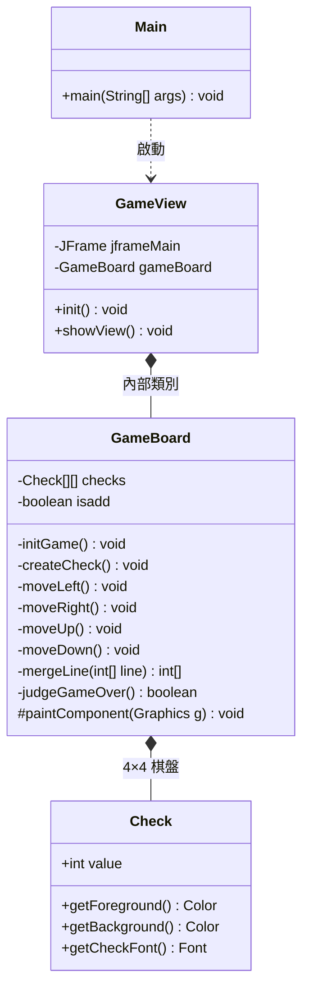

# Java 2048 程式架構

本文件依照 GitHub Repository 中的 `Main.java`、`GameView.java` 與 `Check.java` 原始碼整理，說明 Java 2048 遊戲的類別結構與主要職責。

三個原始碼檔案皆位於 `Main` package，`GameBoard` 為 `GameView` 的內部類別。

**註：** `GameBoard` 是 `GameView.java` 中的內部類別，並非獨立的 `GameBoard.java` 檔案。
